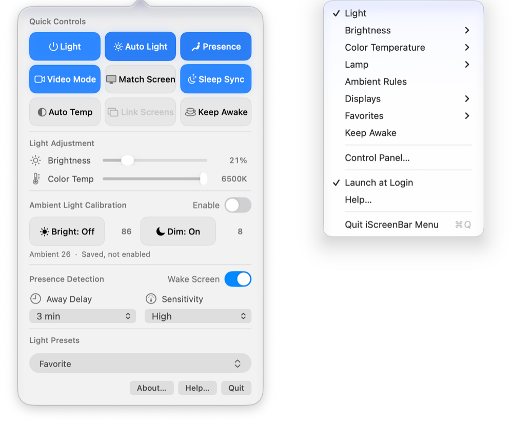

# iScreenBar Menu Quick Guide

iScreenBar Menu is a menu bar app that keeps a BenQ iScreenBar in step with an Apple Studio Display: the lamp turns off when the display sleeps and back on when it wakes. It can also follow the display's brightness, switch the lamp by room light, and manage a MacBook's built-in display.

**You need:** a Mac with macOS 14 or later (macOS 26 for Control Center controls and the widget), an Apple Studio Display, and a BenQ iScreenBar connected by USB.

## Get started

1. **Install.** Drag **iScreenBar Menu** from the DMG to `/Applications`.
2. **Open it once.** A sun icon appears in the menu bar. There's no Dock icon. Yellow means the lamp is on, gray off, red needs attention.
3. **Start at login.** Right-click the icon and choose **Launch at Login**.
4. **Set the light.** Left-click the icon to open the control panel and adjust **Brightness** and **Color Temp**. **Sleep Sync** is already on, so the lamp now follows the Studio Display's sleep and wake.
5. **Optional: room light.** Under Ambient Light Calibration, click **Bright: Off** when the room is bright enough without the lamp, **Dim: On** when it's dark enough to need it, then turn on **Enable**.

## Features at a glance

| Feature | What it does |
| --- | --- |
| Light | Power, brightness, color temperature (2700–6500 K); changes made on the lamp show up in the app |
| Sleep Sync | Lamp off when the Studio Display sleeps, back on when it wakes |
| Wake Screen | Optional: the lamp's presence detection turning the lamp on wakes the sleeping display |
| Match Screen / Link Screens | Lamp follows the display's brightness; MacBook and Studio Display brightness stay linked |
| Ambient Rules | Lamp off in a bright room, on in a dark one, from the Studio Display's light sensor |
| Auto Temp | Cooler by day, warmer at night, by local time |
| Favorites / Mode Center | Saved light modes (light plus Match Screen, Auto Light, Presence, Auto Temp) you can add, edit, reorder, and delete; an associated app applies its mode when it comes to the front, and your setting returns when you switch away |
| Built-in Display | On/off and rotation; forced back on when the Studio Display is unplugged |
| Keep Awake | Keeps the Mac from sleeping until you turn it off or quit |
| Automation | AppleScript, Shortcuts, Control Center controls, and a desktop widget |

## Good to know

- Don't run the BenQ app at the same time; both write lamp settings.
- Wake Screen needs Presence and Sleep Sync on, and the lamp must have been off for a minute before it can wake the display.
- The Studio Display button is a black overlay; the backlight stays on.
- With Launch at Login on, the log is at `~/Library/Logs/iScreenBarMenu.log`.

## More

Choose **Help…** from the menu bar icon (panel or menu) for the full guide to every control.
