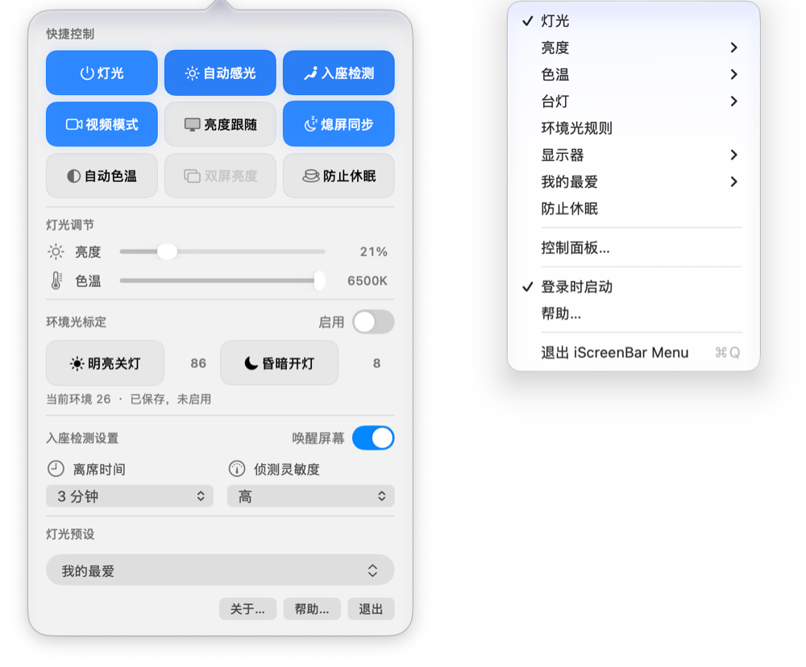

# iScreenBar Menu 快速指南

iScreenBar Menu 是一款菜单栏 App，让 BenQ iScreenBar 与 Apple Studio Display 保持同步：显示器休眠时关灯，唤醒时重新开灯。它还可以让台灯跟随显示器亮度、按室内光线开关台灯，并管理 MacBook 内建显示器。

**需要：** macOS 14 或更高版本的 Mac（控制中心控制项和小组件需要 macOS 26）、Apple Studio Display，以及通过 USB 连接的 BenQ iScreenBar。

## 快速开始

1. **安装。** 将 **iScreenBar Menu** 从 DMG 拖到“应用程序”文件夹。
2. **打开一次。** 菜单栏出现太阳图标，App 不显示 Dock 图标。黄色表示灯亮，灰色表示灯灭，红色表示需要处理的问题。
3. **登录时启动。** 右键点击图标，选择**登录时启动**。
4. **调节灯光。** 左键点击图标打开控制面板，调节**亮度**和**色温**。**熄屏同步**默认开启，台灯会随 Studio Display 休眠和唤醒。
5. **可选：按室内光线开关。** 在“环境光标定”中，室内足够亮、不需要台灯时点击**明亮关灯**，室内暗到需要台灯时点击**昏暗开灯**，然后打开**启用**。

## 功能一览

| 功能 | 作用 |
| --- | --- |
| 灯光 | 开关、亮度、色温（2700–6500K）；在灯体上做的调整会同步显示 |
| 熄屏同步 | Studio Display 休眠时关灯，唤醒后恢复 |
| 唤醒屏幕 | 可选：灯体入座检测把灯打开时，唤醒休眠的显示器 |
| 亮度跟随 / 双屏亮度 | 台灯跟随显示器亮度；MacBook 与 Studio Display 亮度联动 |
| 环境光规则 | 根据 Studio Display 光线传感器，室内明亮时关灯，昏暗时开灯 |
| 自动色温 | 按本地时间白天偏冷、夜间偏暖 |
| 我的最爱 / 模式中心 | 可添加、编辑、排序和删除的灯光模式（灯光及亮度跟随、自动感光、入座检测、自动色温）；关联的 App 切到前台时自动应用其模式，切走后恢复你的设置 |
| 内建显示器 | 开关与旋转；拔出 Studio Display 时强制恢复 |
| 防止休眠 | 在关闭或退出前阻止 Mac 休眠 |
| 自动化 | AppleScript、快捷指令、控制中心控制项和桌面小组件 |

## 注意事项

- 不要同时运行 BenQ 官方 App，两者都会写入台灯设置。
- 唤醒屏幕需要开启入座检测和熄屏同步，且灯需先关闭一分钟才能唤醒显示器。
- Studio Display 按钮只是黑色遮罩，背光保持开启。
- 开启登录时启动后，日志位于 `~/Library/Logs/iScreenBarMenu.log`。

## 更多

在菜单栏图标（面板或菜单）中选择**帮助…**，查看每个控件的完整说明。
