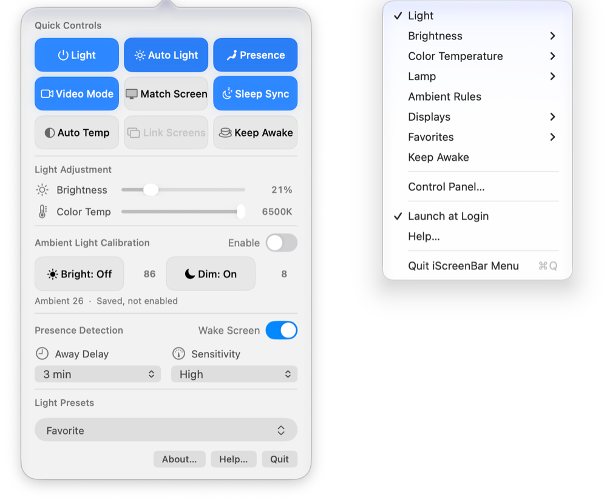
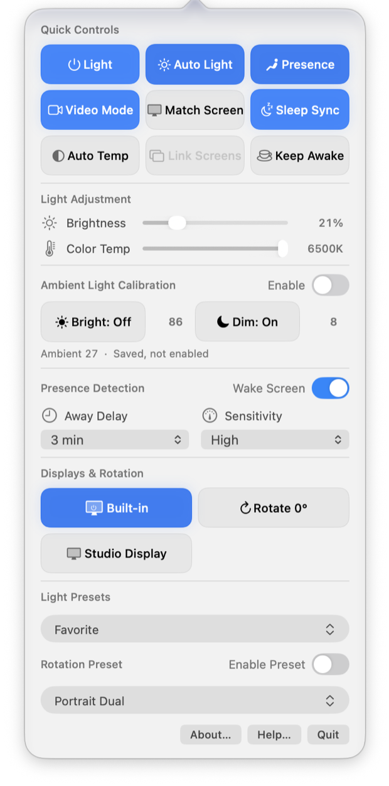

# iScreenBar Menu UI Guide

English · [简体中文](UI-GUIDE.zh-CN.md)

For a one-page overview and setup steps, see the [Quick Guide](QUICK-GUIDE.md).

This page walks through the control panel from top to bottom. Screenshots of the current panel are still to come; the green-dot and log images in the repository are from an early version and do not show the current interface.

Button names below are the English UI labels. With the app in Chinese, see the Chinese guide for the matching labels.

## Opening the menu and the panel

- **Left-click** the icon for the control panel described below. **About…** (app name and version), **Help…**, and **Quit** are at the bottom right.
- **Right-click** (or Control-click) the menu bar icon for a standard menu. It covers the everyday controls: Light; Brightness (25/50/75/100%); Color Temperature (Auto Temp or 2700/4000/5000/6500K); Lamp (Auto Light, Presence, Video Mode, Match Screen, Link Screens, Sleep Sync, Wake Screen on Presence); Ambient Rules; Displays (Built-in Display, Rotate Built-in 0°/90°/180°/270°, Studio Display, apply or auto-apply the rotation preset); Favorites (light presets and Mode Center…); and Keep Awake. Below those are **Control Panel…**, **Launch at Login**, **Help…** (opens the Help window), and **Quit iScreenBar Menu** (⌘Q).

The Help window describes the menu, every panel section, Launch at Login, troubleshooting, and privacy, in the app's current language. It follows the system light/dark Appearance, even if you switch while it's open.

Menu items and panel controls share the same settings, so a change in one shows up in the other. Rotation from the menu uses the same 5-second confirmation as the panel. Items are dimmed whenever the matching panel control is (for example, lamp items while the lamp is disconnected, or Ambient Rules before calibration).

**Launch at Login** adds or removes the user LaunchAgent `~/Library/LaunchAgents/org.windholm.iScreenBarMenu.plist`, the same one `scripts/install.sh` creates. Quit keeps the app closed until the next login; launchd only restarts it after a crash.

## 1. Quick Controls

A highlighted button is on; gray means off or unavailable.

| Button | Use |
| --- | --- |
| Light | Turn the lamp on or off manually |
| Auto Light | Let the lamp's own sensor adjust the light; mutually exclusive with Match Screen |
| Presence | Use the lamp's presence detection; set the away delay and sensitivity below |
| Video Mode | Turn on the video lighting mode manually |
| Match Screen | Set the lamp and Studio Display to comfortable brightness first, then turn this on to record the difference |
| Sleep Sync | Turn the lamp off when the Studio Display sleeps and restore it by the rules on wake |
| Auto Temp | Adjust color temperature gradually by local time; the manual color temperature slider is limited while on |
| Link Screens | Sync brightness changes between the MacBook display and Studio Display, keeping the initial difference |
| Keep Awake | Asks for administrator authorization, then enables the forced layer; the display can still sleep normally. Turn it off when done |

## 2. Light Adjustment

The brightness and color temperature sliders show the values read back from the lamp. 1% is the lowest control level, not fully off; to turn the lamp off, use **Light**. Auto Temp follows the time of day; it does not measure ambient color temperature with a sensor.

## 3. Ambient Light Calibration

Click **Bright: Off** when the room is bright enough, and **Dim: On** when you need extra light; each records the current sensor value. The button only highlights briefly on capture, and the saved value stays on the right. **Enable** next to the heading reuses the saved thresholds, so you don't need to recalibrate every day.

"Ambient" is a filtered, relative value from the Studio Display sensor, not a calibrated light meter. Turning off and fast turning on each need about 30 seconds of sustained readings; the gradual turn-on takes about 45 seconds. Between the two points the lamp may keep its current state. Sleep Sync has priority: a darker room cannot turn the lamp on while the display is asleep.

The rules only turn the lamp on and off; they don't dim it. **Enable** stays unavailable until at least one threshold is saved. For dimming that follows the room, use **Match Screen** with the Studio Display's automatic brightness, or **Auto Light**.

## 4. Presence Detection

On the left is the away delay (3/5/10 minutes); on the right is the sensitivity (Low/Medium/High). While the ambient off-lock is active or the screen is off, the app temporarily pauses presence detection and restores the previous state afterward.

**Wake Screen** (switch next to the heading, off by default) changes the screen-off part: presence detection keeps running while the Studio Display sleeps, and when you come back after the away delay and the lamp turns itself on, the display wakes too. It needs Presence and Sleep Sync, and is unavailable while Sleep Sync is off. A locked Mac shows the lock screen. Someone passing within the sensor's range can also wake the display; lower the sensitivity if that happens. If the display doesn't wake within 10 seconds, Sleep Sync turns the lamp off again. The lamp must have been off for a minute first, so locking the Mac while you stay seated doesn't wake the display again.

## 5. Displays & Rotation

**Built-in** controls the MacBook's built-in display. It can only be turned off while an external display is connected; unplugging the Studio Display forces the built-in display back on. **Rotate** cycles through 0°, 90°, and 270°, and reverts if you don't confirm within 5 seconds.

**Studio Display** covers the screen with a pure black overlay. Windows don't move, but the backlight stays powered. Double-click the black screen or click the button again to restore.

On a Mac with no built-in display (Mac mini, Mac Studio) and only the Studio Display connected, this section and the Rotation Preset rows are hidden, since there's nothing to switch or rotate. Studio Display stays available in the menu under **Displays**. Connect a second display and the section returns.

## 6. Light Modes and Rotation Preset

A light mode saves brightness, color temperature, video mode, and whether Match Screen, Auto Light, Presence, and Auto Temp are on; applying it restores all of them. Pick one from the panel's mode button or **Favorites** in the menu. **Mode Center…** (at the bottom of both) lists the modes, where you add (**+**), delete (**−**), edit (**Edit…** or double-click), reorder (drag, or ▲▼), and apply them. Its **App Associations** list ties an app to a mode, which is then applied whenever that app comes to the front. Modes are separate from the lamp's own hardware memory.

The rotation preset controls display configuration on its own. With **Enable Preset** on, the saved rotation is applied when the Studio Display connects; with it off, the built-in display returns to 0° landscape and stays there on reconnect. Turning it off does not delete the saved preset.

## 7. Automation

AppleScript, Shortcuts, and Control Center (macOS 26) change the same settings as the panel, and the panel and menu show the result. A setting that's dimmed in the panel can't be changed by automation either; the script or shortcut gets an error instead. Control Center controls are buttons without state and need the app to be running. The Lamp Levels widget shows the current brightness and color temperature as segmented bars; click a segment to set it. See the README's Automation section for the full list and an AppleScript example.

## Reporting problems

Behavior may differ across firmware and macOS versions. When reporting a problem, include the macOS version, device models and firmware, steps, and a redacted log.
