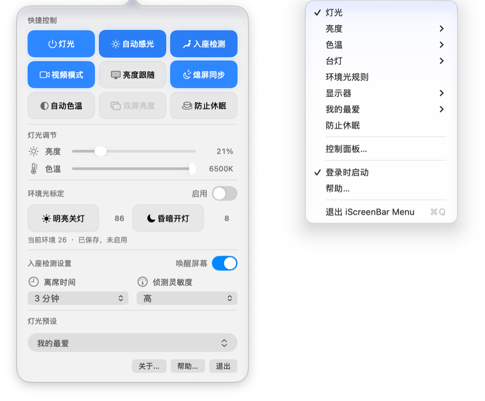
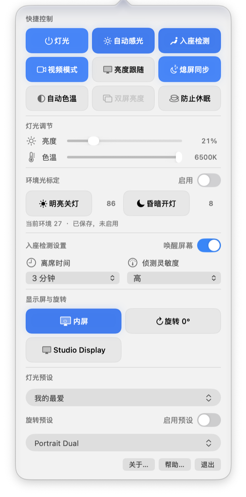

# iScreenBar Menu 界面使用指南

[English](UI-GUIDE.md) · 简体中文

一页概览与上手步骤见 [快速指南](QUICK-GUIDE.zh-CN.md)。

本页按当前菜单面板从上到下说明。新版面板截图待补充；仓库旧绿点和日志图片属于早期版本，不代表当前界面。

## 打开菜单与面板

- **左键点击**图标打开下文介绍的控制面板，右下角有**关于…**（App 名称与版本）、**帮助…**和**退出**按钮。
- **右键点击**（或按住 Control 点击）菜单栏图标打开标准菜单，包含常用控制：灯光；亮度（25/50/75/100%）；色温（自动色温或 2700/4000/5000/6500K）；台灯（自动感光、入座检测、视频模式、亮度跟随、双屏亮度、熄屏同步、入座时唤醒屏幕）；环境光规则；显示器（内建显示器、旋转内屏 0°/90°/180°/270°、Studio Display、应用或自动应用旋转预设）；我的最爱（灯光预设与模式中心设置…）；防止休眠。下方是**控制面板…**、**登录时启动**、**帮助…**（打开帮助窗口）和**退出 iScreenBar Menu**（⌘Q）。

帮助窗口以 App 当前语言介绍菜单、各面板区域、登录时启动、故障排除与隐私，并跟随系统浅色/深色外观，打开时切换外观也会即时更新。

菜单项与面板控件使用同一套设置，在一处更改会同步到另一处。从菜单旋转内屏同样需要 5 秒内确认。面板控件不可用时，对应菜单项也会变灰（例如台灯未连接时的灯光项，或尚未标定时的环境光规则）。

**登录时启动**会添加或移除用户 LaunchAgent `~/Library/LaunchAgents/org.windholm.iScreenBarMenu.plist`，与 `scripts/install.sh` 创建的相同。退出后在下次登录前保持关闭，launchd 只在崩溃后重启。

## 1. 快捷控制

按钮高亮表示开启，灰色表示关闭或不可用。

| 按钮 | 用法 |
| --- | --- |
| 灯光 | 手动开关灯 |
| 自动感光 | 由灯体传感器调节灯光；与亮度跟随互斥 |
| 入座检测 | 使用灯体检测，离席时间和灵敏度在下方设置 |
| 视频模式 | 手动启用视频灯光模式 |
| 亮度跟随 | 先把灯和 Studio Display 调到舒适亮度，再开启以记录差值 |
| 熄屏同步 | Studio Display 熄屏后关灯，唤醒后按规则恢复 |
| 自动色温 | 根据本地时间逐渐调整色温，开启后手动色温滑块受限 |
| 双屏亮度 | 同步 MacBook 与 Studio Display 的亮度变化，保留初始差值 |
| 防止休眠 | 请求管理员授权后启用强制层，允许显示器正常熄屏；用完请关闭 |

## 2. 灯光调节

亮度与色温滑块旁显示灯体回读数值。灯的 1% 为控制范围下限，不代表完全熄灭；完全关闭请点“灯光”。自动色温按时间调整，并不是通过光线传感器识别环境色温。

## 3. 环境光标定

在你认为足够明亮时点击“明亮关灯”，在需要补光时点击“昏暗开灯”，分别记录当前传感器数值。采集只短暂高亮，右侧保留标定结果。标题旁“启用”用于重复使用已存阈值，无需每天重新采集。

“当前环境”是 Studio Display 传感器经滤波后的相对数值，不是校准照度计。关灯与快速开灯约需持续 30 秒，渐进回开约 45 秒；中间范围可能保持原状态。熄屏同步优先，环境变暗不能在显示器熄屏时把灯唤起。

这组规则只开关台灯，不会调暗。至少保存一个阈值后，“启用”才可用。若想随室内光线调暗，请将**亮度跟随**与 Studio Display 自动亮度配合使用，或使用**自动感光**。

## 4. 入座检测设置

左侧是离席时间（3/5/10 分钟），右侧是侦测灵敏度（低/中/高）。环境关灯或熄屏期间，软件会临时暂停入座检测，解除后按之前状态恢复。

标题旁的**唤醒屏幕**开关（默认关闭）改变熄屏时的行为：Studio Display 休眠期间入座检测保持运行；离席超过离席时间后回到座位、灯体自行开灯时，显示器也会被唤醒。需要开启入座检测和熄屏同步，熄屏同步关闭时不可用。Mac 已锁定时显示锁定屏幕。有人从传感器侦测范围内经过也可能唤醒显示器，如有此情况可调低灵敏度。若 10 秒内显示器未被唤醒，熄屏同步会重新关灯。灯需先关闭一分钟才会触发，因此锁定 Mac 后仍坐在座位上不会再次唤醒显示器。

## 5. 显示屏与旋转

“内屏”控制 MacBook 内建显示器；只有连接外接显示器才允许关闭，拔掉 Studio Display 后强制恢复内屏。旋转按 0°、90°、270° 循环，5 秒内不确认则回退。

“Studio Display”使用纯黑遮罩临时遮住画面，窗口不会搬动，但背光并未断电。双击黑色画面或再次开启按钮可以恢复。

在没有内建显示器的 Mac（Mac mini、Mac Studio）上，若只连接 Studio Display，本节和旋转预设两行会隐藏，因为没有可开关或旋转的屏幕。Studio Display 仍可在菜单的**显示器**中使用；连接第二台显示器后本节会重新出现。

## 6. 灯光模式与旋转预设

灯光模式保存亮度、色温、视频模式，以及亮度跟随、自动感光、入座检测和自动色温的开关状态；应用时全部恢复。可在面板的模式按钮或菜单的“我的最爱”中选择。两处底部的“模式中心设置…”列出所有模式，可以添加（**+**）、删除（**−**）、编辑（“编辑…”或双击）、调整顺序（拖动或 ▲▼）和应用。其中的“应用关联”列表把 App 关联到某个模式，该 App 切到前台时自动应用；切到没有模式的 App 时恢复之前的设置。在模式的“编辑…”表单中，“快捷指令”和“AppleScript”用于选择设置台灯后还要运行的内容。模式中心底部的“台灯动作”部分可在台灯开启或关闭时运行快捷指令和/或 AppleScript。模式与灯体自己的硬件记忆不同。

旋转预设单独控制显示配置：“启用预设”开启时，连接 Studio Display 后应用保存的旋转角度；关闭时恢复 0° 横屏，重新连接也保持横屏。关闭不会删除已保存的预设。

## 7. 自动化

AppleScript、快捷指令和控制中心（macOS 26）修改的是与面板相同的设置，面板和菜单会显示结果。面板中变灰的设置同样无法通过自动化更改，脚本或快捷指令会收到错误。控制中心控制项是没有状态的按钮，需要 App 在运行。“台灯亮度与色温”小组件以分段条显示当前亮度和色温，点按某一格即可设置。完整列表与 AppleScript 示例见 README 的“自动化”一节。

## 问题反馈

不同固件和 macOS 版本可能有差异。反馈问题时请提供系统版本、设备型号与固件、操作步骤和脱敏日志。
